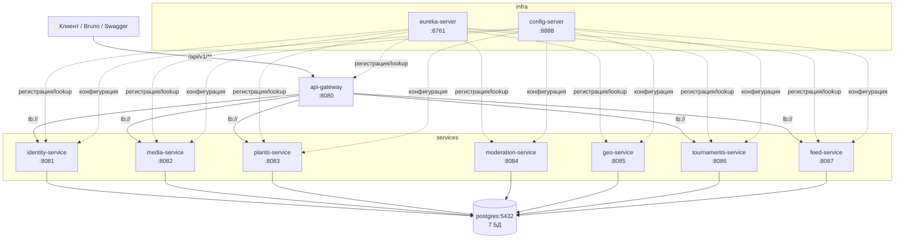
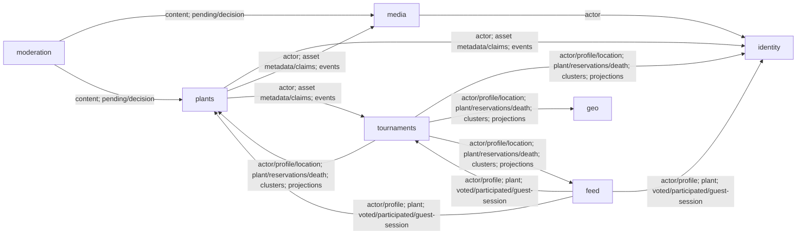

# Архитектура лабы №2 — микросервисы

Монолит лабы №1 разрезан на 7 сервисов по bounded contexts (план разрезания —
`docs/plans/2026-10-23-lab2-microservices.md`; исходник — `monolith-reference/`).
Инфраструктура: Eureka (service discovery), Config Server, Spring Cloud
Gateway. Все межсервисные вызовы — Feign/HTTP через Eureka; события —
HTTP-команды и polling (ADR-015).

## Общая диаграмма

Gateway маршрутизирует `/api/v1/**` по префиксам путей (tournaments, feed,
plants, media, identity) на `lb://<service>` через Eureka; прямые маршруты
`/<service>/**` со `StripPrefix=1` — для Swagger UI и отладки. Конфигурация:
`api-gateway/src/main/resources/application.yml`.

## Граф зависимостей Feign (направление вызовов)

Текстом (потребитель → поставщики):

| Сервис (Feign-клиент) | Вызывает | Что берёт |
|---|---|---|
| media | identity | `CurrentActor` по userId |
| plants | identity | `CurrentActor` |
| plants | media | метаданные/контент asset, `claim/release` (ADR-008) |
| plants | tournaments | событие `PlantModerationDecided` (HTTP POST) |
| moderation | media | байты файла для инференса |
| moderation | plants | PENDING-растения (polling), решение модерации |
| tournaments | identity | actor, профиль, локация |
| tournaments | plants | растение, резерв/подтверждение/освобождение, гибель |
| tournaments | geo | кластеризация эпохи (ADR-012) |
| tournaments | feed | проекция окна (открытие/закрытие) |
| feed | identity | actor, публичный профиль |
| feed | plants | публичные данные растения |
| feed | tournaments | оценённые entry, турниры участия, гостевая сессия |

Направления совпадают с допустимыми зависимостями context map
(«Потребитель владеет своим портом»): у каждого сервиса свой Feign-клиент
со своими view-записями в `api.client`, in-process ACL-адаптеры лабы №1
заменены без изменения домена и application.

## База данных — по сервису

Один контейнер PostgreSQL 17, **база на сервис** (не схема на контекст,
как в монолите) — `scripts/docker/init-databases.sql` / `scripts/local/create-databases.sql`.
Миграции Flyway перенесены без изменений (`classpath:db/migration`,
схема внутри БД = имени контекста).

| Сервис | База | Доступ |
|---|---|---|
| identity-service | `identity` | JDBC (JPA) |
| media-service | `media` | JDBC (JPA) |
| plants-service | `plants` | JDBC (JPA) |
| moderation-service | `moderation` | JDBC (JPA) |
| tournaments-service | `tournaments` | JDBC (JPA, блочно через `Blocking` — ADR-014) |
| geo-service | `geo` | R2DBC (миграции — JDBC Flyway) |
| feed-service | `feed` | JdbcClient (WebFlux) |

## Порты

| Компонент | Порт |
|---|---|
| api-gateway | 8080 |
| identity-service | 8081 |
| media-service | 8082 |
| plants-service | 8083 |
| moderation-service | 8084 |
| geo-service | 8085 |
| tournaments-service | 8086 |
| feed-service | 8087 |
| eureka-server | 8761 |
| config-server | 8888 |
| postgres | 5432 (внутри compose-сети) |

## Доставка событий (лаба №2)

| Событие | Издатель → Потребитель | Доставка | Идемпотентность |
|---|---|---|---|
| `PlantModerationDecided` | plants → tournaments | `@TransactionalEventListener(AFTER_COMMIT)` → Feign `POST /internal/events/plant-moderation-decided` (ADR-015) | повтор — no-op по состоянию заявки (INVITED/READY/терминальные) |
| `VotingWindowOpened` / `VotingWindowClosed` | tournaments → feed | Feign `POST /internal/feed/projections` / `DELETE /internal/feed/projections/{windowId}` | создание/удаление карточек окна по windowId |
| `PlantSubmitted` | plants → moderation | **polling**: moderation опрашивает `GET /internal/plants?moderationStatus=PENDING` (fixedDelay 5с) | создание задания идемпотентно по plantId |
| retry заданий модерации | moderation (внутренний) | `ModerationJobPoller` (fixedDelay 2с, backoff 1с→…→кап 1ч) | по состоянию задания |

Outbox/Kafka — план лабы №4 (context map, «Эволюция»); в лабе №2
AFTER_COMMIT-relay без outbox может потерять событие при падении между
commit и POST — компенсируется идемпотентностью команд и polling
(ADR-015).

## Стеки сервисов

| Сервис | Web | Доступ к данным |
|---|---|---|
| identity, media, plants, moderation | Spring MVC | JPA |
| tournaments | WebFlux | JPA блочно (`shared-webflux.Blocking`, ADR-014) |
| geo | WebFlux | R2DBC |
| feed | WebFlux | JdbcClient |

Общие модули: `shared-lib` (security, ApiError, события — без веб-стека),
`shared-web` (servlet-фильтры/обработчик), `shared-webflux` (reactive-аналоги)
— ADR-017.
